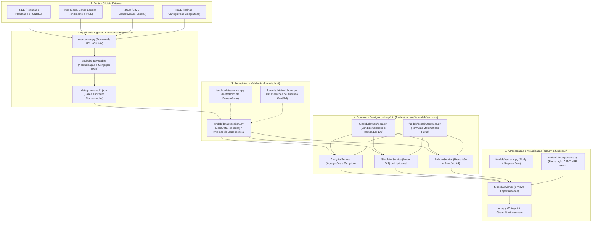

# Documentação Técnica e Linhagem dos Dados (Data Lineage)
## Painel Estratégico FUNDEB & Complementação VAAR 2026

**Autor:** Equipe de Engenharia e Ciência de Dados  
**Público-Alvo:** Gestores Públicos, Auditores de Controle Externo, Engenheiros de Software e Pesquisadores  
**Normas de Referência:** Lei nº 14.113/2020, Emenda Constitucional nº 108/2020, Portarias Interministeriais MEC/MF nº 5/2024 e nº 11/2026, Nota Técnica Inep nº 23/2022  
**Data da Documentação:** Outubro de 2026  

---

## 1. Visão Geral da Arquitetura do Sistema

O projeto foi concebido seguindo princípios modernos de **Engenharia de Software (SOLID, Clean Architecture e Inversão de Controle)** e **Design de Informação (Stephen Few)**. O sistema opera de forma puramente determinística sobre bases públicas oficiais: **não há dados sintéticos, simulações fictícias ou valores gerados aleatoriamente**.



---

## 2. Linhagem dos Dados (*Data Lineage* e Proveniência)

A linhagem detalha como cada variável sai do documento governamental primário até a sua renderização na tela.

### 2.1. Matriz de Fontes Primárias e Arquivos Processados

| Arquivo em `data/processed/` | Órgão Primário | Documento / Publicação Oficial de Origem | Conteúdo Extraído |
| :--- | :--- | :--- | :--- |
| **`base_clean.json`** | **FNDE / MEC** | Publicações Fundeb 2026 (Portaria MEC/MF nº 11/2026) e Lista de Entes Beneficiários/Não Beneficiários VAAR 2026. | Receita de contribuição, VAAF, VAAT, VAAR (parcelas atendimento e aprendizagem), condicionalidades I a V, habilitação e pendências de todos os 5.596 entes. |
| **`v2025.json`** | **FNDE** | Portaria MEC/MF nº 5 de 29/04/2024 (Ciclo VAAR 2025). | Valores auditados recebidos do VAAR em 2025 (R$) por código IBGE. |
| **`ideb.json`** | **Inep** | Divulgação Oficial Ideb 2025 (Municípios e UFs). | Ideb Anos Iniciais, Finais e Ensino Médio; Proficiência média Saeb em Língua Portuguesa e Matemática. |
| **`rend.json`** | **Inep** | Indicadores Educacionais de Rendimento Escolar (Censo 2025). | Taxas percentuais de aprovação, reprovação e abandono escolar (Fundamental e Médio). |
| **`inse.json`** | **Inep** | Nível Socioeconômico dos Municípios (INSE 2023). | Classificação socioeconômica contínua das famílias dos estudantes. |
| **`conect.json`** | **NIC.br / SIMET** | Projeto Educação Conectada (Base dos Dados). | % de escolas com internet, % com internet adequada à aprendizagem e velocidade média (Mbps). |
| **`sim_atend.json`** | **Inep / Censo** | Censo Escolar 2017–2023 compilado no repositório *guimaraesca/Simulador-VAAR-PI*. | Matrículas por etapa avaliada (Creche/Pré-escola para municípios; Ensino Médio para estados) e série do IEE. |
| **`geo/*.json`** | **IBGE** | Malhas Cartográficas Municipais e Estaduais simplificadas. | Coordenadas GeoJSON para renderização dos mapas cloropléticos. |

---

## 3. Dicionário de Variáveis e Mapeamento de Atributos

O DataFrame unificado disponibilizado por [`JsonDataRepository.entes()`](file:///Users/carlosarturguimaraes/Downloads/fundeb-painel/fundeb/data/repository.py#L82-L138) consolida 5.596 linhas (26 Estados + DF + 5.569 Municípios) com as seguintes colunas:

### 3.1. Identificação Territorial e Administrativa
* **`ibge`** *(str)*: Código único IBGE do município (7 dígitos) ou do estado (2 dígitos). Chave primária do sistema.
* **`uf`** *(str)*: Sigla da Unidade da Federação.
* **`regiao`** *(str)*: Macrorregião geográfica (Norte, Nordeste, Centro-Oeste, Sudeste, Sul).
* **`nome`** *(str)*: Nome oficial do município ou rótulo padronizado da rede estadual (*"Rede estadual — UF"*).
* **`rede`** *(str)*: Esfera governamental (`"Municipal"` ou `"Estadual"`).

### 3.2. Financiamento Oficial do FUNDEB (Valores em Reais - R$)
* **`receita_contrib`** *(float)*: Receita arrecadada que compõe a contribuição do ente ao FUNDEB (20% dos impostos vinculados).
* **`vaaf`** *(float)*: Valor Aluno Ano Fundeb — Complementação da União aos fundos estaduais com valor abaixo do piso nacional.
* **`vaat`** *(float)*: Valor Aluno Ano Total — Complementação focada nas redes de ensino com menor receita total disponível.
* **`vaat_ei`** *(float)*: Parcela da complementação VAAT vinculada à Educação Infantil (mínimo legal de 50%).
* **`vaar`** *(float)*: Valor Aluno Ano Resultado — Complementação total prevista/publicada para o ente no ciclo 2026.
* **`vaar_2025`** *(float)*: Complementação VAAR efetivamente paga ao ente no exercício financeiro de 2025.
* **`uniao_total`** *(float)*: Soma total dos repasses da União ao ente ($\text{VAAF} + \text{VAAT} + \text{VAAR}$).
* **`vaar_atend`** *(float)*: Parcela de 50% do VAAR atrelada ao Indicador de Atendimento ($I_{atend}$).
* **`vaar_aprend`** *(float)*: Parcela de 50% do VAAR atrelada ao Indicador de Aprendizagem ($I_{aprend}$).
* **`transicao`** *(str)*: Comportamento da rede entre os ciclos 2025 e 2026 (`"Manteve"`, `"Perdeu"`, `"Entrou"`, `"Fora"`).

### 3.3. Habilitação e Condicionalidades de Gestão (Art. 14 da Lei nº 14.113/2020)
* **`c1`** *(bool)*: Inciso I — Provimento do cargo de diretor por critérios técnicos de mérito e desempenho ou eleição com comunidade.
* **`c2`** *(bool)*: Inciso II — Participação de pelo menos 80% dos estudantes nas avaliações do Saeb.
* **`c3`** *(bool)*: Inciso III — Redução das desigualdades educacionais socioeconômicas e raciais.
* **`c4`** *(bool)*: Inciso IV — Regime de colaboração formalizado (lei estadual de ICMS Educação $\ge 10\%$).
* **`c5`** *(bool)*: Inciso V — Referenciais curriculares alinhados à BNCC e homologados nos Conselhos de Educação com os anexos obrigatórios.
* **`habilitado`** *(bool)*: Elegibilidade legal. Verdadeiro se e somente se o ente cumpriu todas as 5 condicionalidades de gestão.
* **`beneficiario`** *(bool)*: Se o ente, além de habilitado, demonstrou evolução pedagógica positiva e recebeu repasse financeiro do VAAR.
* **`pendencia`** *(str)*: Descrição textual da pendência declarada na lista oficial do MEC/FNDE.
* **`n_reprovacoes`** *(int)*: Quantidade de condicionalidades reprovadas pelo ente (0 a 5).

### 3.4. Indicadores Pedagógicos, de Fluxo e Conectividade
* **`saeb_ai_lp`**, **`saeb_ai_mt`** *(float)*: Proficiência média Saeb nos Anos Iniciais do EF (Língua Portuguesa e Matemática).
* **`saeb_af_lp`**, **`saeb_af_mt`** *(float)*: Proficiência média Saeb nos Anos Finais do EF.
* **`saeb_em_lp`**, **`saeb_em_mt`** *(float)*: Proficiência média Saeb no Ensino Médio.
* **`aprov_fund`**, **`reprov_fund`**, **`aband_fund`** *(float)*: Taxas percentuais de aprovação, reprovação e abandono no Ensino Fundamental.
* **`aprov_med`**, **`aband_med`** *(float)*: Taxas percentuais no Ensino Médio.
* **`inse`** *(float)*: Indicador de Nível Socioeconômico calculado pelo Inep.
* **`net_aprend_pct`** *(float)*: Percentual de escolas da rede com conexão à internet adequada para fins de aprendizagem.

---

## 4. Formalização Matemática e Regras de Domínio

As fórmulas implementadas em [`fundeb/domain/formulas.py`](file:///Users/carlosarturguimaraes/Downloads/fundeb-painel/fundeb/domain/formulas.py) seguem estritamente a Nota Técnica Inep nº 23/2022 e as regras legais da Lei nº 14.113/2020.

### 4.1. Invariantes Contábeis do FUNDEB (Verificação Automática)

O módulo de auditoria [`fundeb/data/validation.py`](file:///Users/carlosarturguimaraes/Downloads/fundeb-painel/fundeb/data/validation.py) executa checagens formais linha a linha:

1. **Fechamento dos Repasses da União:**
   $$\forall r \in \text{Redes}, \quad \left| \left( \text{VAAF}_r + \text{VAAT}_r + \text{VAAR}_r \right) - \text{Compl\_União\_Total}_r \right| \le \text{R\$} 1{,}00$$
2. **Repartição Paritária do VAAR (Cota 50% / 50%):**
   $$\text{VAAR}_r = \text{VAAR\_Atend}_r + \text{VAAR\_Aprend}_r$$
   $$\sum_{r} \text{VAAR\_Atend}_r = 0{,}50 \times \sum_{r} \text{VAAR}_r \quad \text{e} \quad \sum_{r} \text{VAAR\_Aprend}_r = 0{,}50 \times \sum_{r} \text{VAAR}_r$$
3. **Cláusula de Barreira da Habilitação:**
   $$\text{Beneficiário}_r \implies \text{Habilitado}_r \iff \left( c1_r \land c2_r \land c3_r \land c4_r \land c5_r \right)$$
   *(Nenhuma rede pode receber recursos do VAAR se tiver ao menos 1 condicionalidade reprovada).*

---

### 4.2. Módulo VAAR-Atendimento (50% do Montante)

O indicador de atendimento afere o sucesso na permanência escolar e pune omissões de rendimento final (SIR):

$$VAAR\_Atendimento_{r,t} = 1 - \frac{Abandono_{r,t} + 0{,}5 \times SIR_{r,t}}{M_{r,t}}$$

* $Abandono_{r,t}$: Quantidade de estudantes que abandonaram a escola durante o ano letivo.
* $SIR_{r,t}$: Matrículas "Sem Informação de Rendimento" (penalizadas com desconto de 0,5x).
* $M_{r,t}$: Matrículas regulares da base de cômputo da rede.

**Critério de Elegibilidade Financeira:**
$$\Delta VAAR\_Atendimento_r = VAAR\_Atendimento_{r,t} - VAAR\_Atendimento_{r,t-1} \ge 0$$
*(Observada a margem de flutuação e tolerância estatística estabelecida pelo Inep conforme o porte populacional da rede).*

**Ajuste Progressivo de Peso ($peso_{atend}^r$):**
$$peso_{atend}^r = 1 + \left( \frac{VAAR\_Atendimento_{r,t} - Min(VAAR\_Atendimento_t)}{Max(VAAR\_Atendimento_t) - Min(VAAR\_Atendimento_t)} \right) \in [1{,}0; 2{,}0]$$

---

### 4.3. Módulo VAAR-Aprendizagem (50% do Montante)

A métrica síntese da aprendizagem é o produto de três dimensões estruturais:

$$VAAR\_Aprendizagem_{r,t} = Inad_{r,(t,t-1)} \times IPSaeb_{r,t} \times IndEqui_{r,t}$$

1. **Índice de Nível e Avanço de Desempenho ($Inad$):**
   $$Inad = (0{,}3 \times IND + 0{,}7 \times IAD) \times TAp$$
   * $IND$: Índice de Nível de Desempenho (peso 0,3).
   * $IAD$: Índice de Avanço de Desempenho contínuo entre edições (peso 0,7).
   * $TAp$: Taxa de Aprovação escolar (garante que avanços cognitivos não venham acompanhados de represamento por reprovação).
   * O resultado passa por reescalonamento linear para o intervalo $[0, 1]$:
     $$Inad\_Norm = \frac{Inad_{Bruto} - (-7)}{10 - (-7)}$$

2. **Indicador de Participação no Saeb ($IPSaeb$):**
   $$IPSaeb = \begin{cases} 0, & \text{se } \text{Presença} < 0{,}80 \quad (\text{Inabilitação Sumária}) \\ \min(1{,}0; \text{Presença}), & \text{se } \text{Presença} \ge 0{,}80 \end{cases}$$

3. **Índice de Equidade ($IndEqui$):**
   Combina o inverso do nível de desigualdade socioeconômica e racial apurado pelo Inep nos grupos avaliados.

---

### 4.4. Coeficiente de Distribuição Final e Repasse em Reais

Para cada rede habilitada $r$:
$$C_{atend}^r = \frac{M_r \times peso_{atend}^r}{\sum_{i=1}^{n} (M_i \times peso_{atend}^i)} \quad \implies \quad \text{Repasse}_{Atend}^r = C_{atend}^r \times (50\% \text{ do Montante VAAR})$$

$$C_{aprend}^r = \frac{M_r \times peso_{aprend}^r}{\sum_{i=1}^{n} (M_i \times peso_{aprend}^i)} \quad \implies \quad \text{Repasse}_{Aprend}^r = C_{aprend}^r \times (50\% \text{ do Montante VAAR})$$

$$\text{Repasse\_Total\_VAAR}^r = \text{Repasse}_{Atend}^r + \text{Repasse}_{Aprend}^r$$

---

## 5. Como Entender e Navegar pelo Código

O código está estruturado em módulos independentes com baixo acoplamento:

```
fundeb-painel/
├── app.py                          # Ponto de entrada Streamlit e roteamento de abas
├── requirements.txt                # Dependências fixadas (Streamlit, Pandas, Plotly, etc.)
├── Makefile                        # Automação de pipelines de dados
├── fundeb/
│   ├── config.py                   # Diretórios e constantes globais de configuração
│   ├── data/
│   │   ├── sources.py              # Registro formal de proveniência de cada arquivo
│   │   ├── repository.py           # Inversão de dependência: JsonDataRepository
│   │   └── validation.py           # Testes e asserções automáticas de auditoria contábil
│   ├── domain/
│   │   ├── legal.py                # Normativos: 5 Condicionalidades e Rampa EC 108
│   │   ├── formulas.py             # Funções matemáticas puras (NT Inep 23/2022)
│   │   └── territorio.py           # Códigos IBGE, siglas de UFs e macrorregiões
│   ├── services/
│   │   ├── analytics.py            # Estatísticas nacionais, funil de reprovação e rankings
│   │   ├── simulator.py            # Motor contrafactual de 6 hipóteses com índice hash O(1)
│   │   └── boletim.py              # Gerador de relatório executivo de 2 páginas (A4)
│   └── ui/
│       ├── theme.py                # Estilização CSS responsiva e widescreen
│       ├── components.py           # Formatadores estritos ABNT NBR 5892 (moeda, %, número)
│       ├── charts.py               # Gráficos Plotly calibrados nos princípios de Stephen Few
│       └── views/                  # Telas do painel (Home, Boletim, Mapas, Simulador, etc.)
├── tests/
│   ├── test_domain_formulas.py     # Testes unitários das fórmulas matemáticas puras
│   ├── test_services.py            # Testes dos motores de simulação e análise
│   ├── test_formatters.py          # Testes de conformidade da formatação ABNT NBR
│   └── test_boletim.py             # Testes do gerador de boletim em 2 páginas A4
└── data/processed/                 # Bases JSON consolidadas e auditadas
```

---

## 6. Roteiro Passo a Passo para Conferência e Auditoria

Se você deseja auditar se uma informação exibida no painel para um município ou estado específico está correta, siga este procedimento:

### Passo 1: Localizar o Ente na Base Bruta
Abra o arquivo [`data/processed/base_clean.json`](file:///Users/carlosarturguimaraes/Downloads/fundeb-painel/data/processed/base_clean.json) e procure pelo código IBGE do ente (ex.: `"2208007"` para Teresina - PI).
* Verifique o campo `Compl_VAAR`: este é o valor oficial publicado pelo FNDE.
* Verifique os campos `Cond_I`, `Cond_II`, `Cond_III`, `Cond_IV` e `Cond_V`: estes indicam o cumprimento ("Sim"/"Não") de cada condicionalidade.

### Passo 2: Executar as Verificações de Auditoria Automática
No terminal do seu computador, execute o comando de auditoria integrado:
```bash
./.venv/bin/python -c "
from fundeb.data.repository import JsonDataRepository
from fundeb.data.validation import verificar

df = JsonDataRepository().entes()
resultados = verificar(df)
for r in resultados:
    print(f'[{r.status.upper()}] {r.nome}: {r.detalhe}')
"
```
Todas as asserções contábeis devem retornar `[OK]` ou `[ALERTA]` (alertas registram divergências da própria fonte oficial, mantidas para transparência).

### Passo 3: Executar a Suíte de 22 Testes Automatizados
```bash
./.venv/bin/python -m unittest discover tests
```
* **Resultado esperado:** `Ran 22 tests in ~0.7s - OK`.
* Isso certifica que:
  1. A ponderação exponencial e linear $O(1)$ opera sem desvios;
  2. O fechamento contábil e as quotas de 50%/50% estão preservados;
  3. A formatação ABNT NBR não utiliza separadores anglo-saxões;
  4. O boletim gera exatamente 2 páginas A4 sem transbordamento.
